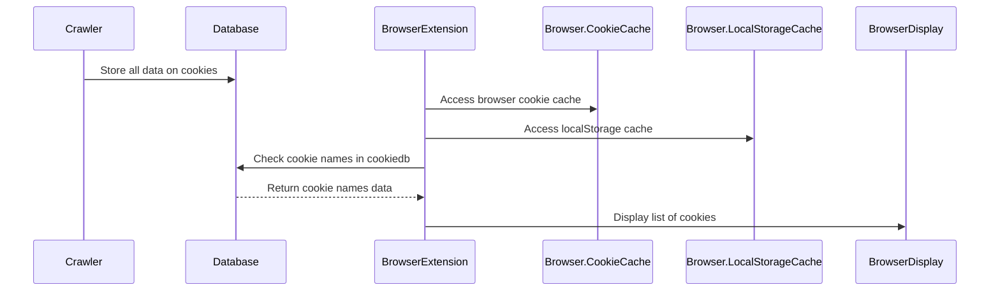

# pricrumb-browser-extension

- CMP included?
  1- OneTrust (OptanonConsent, OptanonAlertBoxClosed)
  2- CookieYes (cookieyes-consent,)
  3- WSCR (wscrCookieConsent)
  4- Complianz (cmplz_rt_functional, cmplz_rt_marketing, cmplz_rt_preferences, cmplz_rt_statistics, cmplz_rt_banner-status)
  5- Usercentrics (uc_userconsen)
  6- Quantcast (quantcast_consent)
  7- Cookiebot (CookieConsent)
  8- Osano (osano_consent)
  9- Cookie Notice (cookie_notice)
  10- Cookie Law Info (cookie_law_info)
  11- TrustArc (TrustArcConsent)

  Missing we can Add?
  1- Cybot?

- prefered_choices.js:
  contai the logic behind creating the cookie table:

  - fetchAndDisplayWebsites: to get the website

- prefered_choices.html:
  contain the layout of the cookietable, where we present users with a list of websites where they interacted with/made action with the websites' cokkie consent
