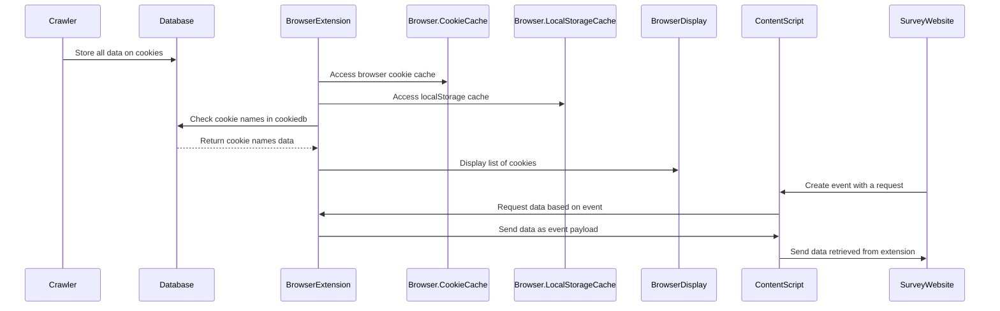

# pricrumb-browser-extension



## Event API

A website can make requests to the browser extension, such as requesting the formatted cookie list. The content.js script acts as a bridge between the extension and website.

### Types Of Requests:

* fetchAllCookies: Request the formatted cookie list from your browser

### How To Make A Request:

1. Ensure website is listed in the extension's [manifest.json](extensions/desktop/chrome/manifest.json) as matching the content script. It MUST include a /* after if you want the content script to be injected on the entire website:
```
"content_scripts": [
    {
      "matches": ["https://example.com/*", "YOUR_WEBSITE_HERE/*"],
      "js": ["content.js"]
    }
  ],
```
2. Ensure your browser has the extension installed
3. On your website, create a ```window.postMessage``` of type "FROM_WEBSITE" and specify the request you want to make as the action in the payload. For example:
```
window.postMessage({ type: "FROM_SURVEY", payload: { action: "fetchAllCookies" } }, "*");
```
4. To receive data from the extension, create a ```window.addEventListener``` to listen for the extension's response. To confirm the response is from the extension, confirm the type is "FROM_EXTENSION". I recommend placing this in a React hook. For example:
```
useEffect(() => {
// Listen for response from extension
const handleMessage = (event) => {
  if (event.data.type === "FROM_EXTENSION") {
    console.log("Data received from extension:", event.data.payload);
  }
};
window.addEventListener("message", handleMessage);
return () => {
  window.removeEventListener("message", handleMessage);
};
}, []);
```
5. Your ```event.data.payload``` contains the requested data. In this example, it contains the entire formatted cookie list from your browser.

### How To Add More Requests To The Extension

In [background.js](extensions/desktop/chrome/background.js), create the following code (or add a new if statement to existing code):
```
chrome.runtime.onMessage.addListener((request, sender, sendResponse) => {
    if (request.payload?.action === 'YOUR_REQUEST_TYPE') {
        ...

        sendResponse({ DATA });
        
        return true; // Keep the message channel open
    }
}
```

In this if statement, you can replace DATA with whatever you would like to send to the website. Be sure to replace YOUR_REQUEST_TYPE with a descriptive name for your request.

## Additional

- CMP included?
  1- OneTrust (OptanonConsent, OptanonAlertBoxClosed)
  2- CookieYes (cookieyes-consent,)
  3- WSCR (wscrCookieConsent)
  4- Complianz (cmplz_rt_functional, cmplz_rt_marketing, cmplz_rt_preferences, cmplz_rt_statistics, cmplz_rt_banner-status)
  5- Usercentrics (uc_userconsen)
  6- Quantcast (quantcast_consent)
  7- Cookiebot (CookieConsent)
  8- Osano (osano_consent)
  9- Cookie Notice (cookie_notice)
  10- Cookie Law Info (cookie_law_info)
  11- TrustArc (TrustArcConsent)

  Missing we can Add?
  1- Cybot?

- prefered_choices.js:
  contai the logic behind creating the cookie table:

  - fetchAndDisplayWebsites: to get the website

- prefered_choices.html:
  contain the layout of the cookietable, where we present users with a list of websites where they interacted with/made action with the websites' cokkie consent
