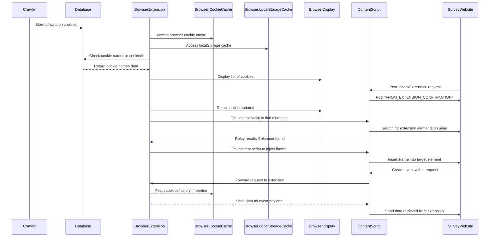

# pricrumb-browser-extension



# Documentation

The browser extension retrieves cookies and browsing data, injects extension pages (HTML iframes) into matching websites, and exchanges messages between the website and background logic using a content-script bridge. It is compatible with Chromium-based browsers and Firefox.

## Key Components

### [background.js](extensions/desktop/merged/background.js)
* Core controller for all background logic.
* Runs as a service worker in Chrome or a background script in Firefox.
* Functionality
    * Handles all ```runtime.onMessage``` events from content scripts.
	* Fetches cookies and browsing history using ```ext.cookies``` and ```ext.history```.
	* Filters cookies using cached domain data (```visitedDomainsCache``` and ```historyCache```).
	* Stores cookie data in ```ext.storage.local```.
	* Injects HTML pages by messaging content scripts (```action: "injectHTML"```).
	* Sends the ```runSurveyElementCheck``` signal when tabs finish loading so the content script can detect and inject required pages.

### [content.js](extensions/desktop/merged/content.js)
* Acts as a bridge between the webpage and background script.
* Functionality:
	* Listens for messages from both the webpage (```window.postMessage```) and the background script.
	* When a webpage posts a ```FROM_SURVEY``` message, forwards it to the background via ```ext.runtime.sendMessage```.
	* When the background sends ```injectHTML```, dynamically appends the corresponding iframe inside the detected HTML element.
	* Detects survey placeholders (IDs like ```pricrumbs_website_all_cookies_accepted```) and triggers iframe injection when they appear.
	* Posts messages back to the webpage (```FROM_CONTENT``` or ```FROM_EXTENSION``` depending on context).

### [popup.js](extensions/desktop/merged/popup.js)
* Controls the popup.html interface that users see when they click the extension icon.
* Functionality:
	* Requests all cookies directly from background script via the ```checkCookies``` API call when the popup loads to populate cookie table and fill the background history cache.
	* Displays detailed cookie data, including domain visit counts, first/last visit timestamps, and average daily visits
	* Can send additional runtime messages (e.g., to refresh cookies or clear stored data).

### [ext-shim.js](extensions/desktop/merged/ext-shim.js)
* Provides a cross-browser compatibility layer between Chrome (callback-based) and Firefox (Promise-based) extension APIs.
	* Makes Chrome APIs behave like Firefox's Promise-based APIs
* It defines a unified ext object:
	* Wraps async APIs (cookies, tabs, storage, downloads, etc.) with Promises.
	* Ensures all code can use await ```ext.cookies.getAll()``` regardless of browser.
* Automatically imported by both background and content scripts.
* The ext object unifies both ```chrome.*``` and ```browser.*``` calls.

### [browser-polyfill.min.js](extensions/desktop/merged/browser-polyfill.min.js)
* Mozilla’s polyfill that normalizes Promise-based behavior in older browsers.
* Required for consistent browser.* compatibility when running in Firefox.

### manifest.json
* Declares all permissions, scripts, and resources.
* Chrome uses ```background.service_worker```, while Firefox requires ```background.scripts```.
* Both [manifest.chrome.json](extensions/desktop/merged/manifest.chrome.json) and [manifest.firefox.json](extensions/desktop/merged/manifest.firefox.json) are manifest.json, so one must be renamed before importing the extension.


## Event API
A website (e.g., the survey) communicates with the extension by posting messages that the content script forwards to the background script.

### Supported API Calls
* checkCookies
	* Initial call that must be performed to gather user cookie data.
	* Provides a full view of cookies.
	* Called directly by [popup.js](extensions/desktop/merged/popup.js) to populate cookie table.
	* Components:
		* Calls ```getVisitedDomains()``` to build and cache a list of all sites visited in the last year.
			* Domain set cached in ```visitedDomainsCache``` and history data per domain in ```historyCache```.
		* Retrieves all cookies via ```ext.cookies.getAll()``` and filters out cookies from unvisited domains.
		* For each remaining domain, looks up browsing history via ```ext.history.getVisits()```.
		* Returns a final array of cookies enriched with: ```firstVisited```, ```lastVisited```, ```totalVisitCount```, and ```avgDailyVisits```.
* fetchAllCookies
	* Retrieve formatted list of all cookies from the browser.
* checkEligibility
	* Checks if the user has visited 10 or more unique websites where they took an explicit consent action.
	* Returns unique domains and website types found (All Accepted, All Rejected, Advertising Rejected, or Default).
* checkDiscrepancies
	* Compares the user's stored 5-point scale preferences against the actual cookie states.
	* Returns a boolean flag indicating if any discrepancies were found.
* downloadCookies
	* Utility to trigger a JSON download of the current filtered cookie data.
* injectHTML: 
	* Embed an extension HTML page into the active tab’s DOM.
	* Example InjectHTML Payload from content script:
		```window.postMessage({
		  type: "FROM_CONTENT",
		  payload: { action: "injectHTML", html: "popup.html" }
		}, "*");```

### How Communication Works
1. Page (or Background Script) → Content Script
	* Direct calls from page:
		* The website posts a message (type ```FROM_SURVEY```).
		* The content script intercepts it via ```window.addEventListener("message", …)```.
	* Indirect calls via page updates (to check for survey-extension elements on page):
		* Background script listens for when a tab finishes loading via ```ext.tabs.onUpdated.addListener()```.
		* Sends message to content script via ```ext.tabs.sendMessage(tabId, { action: "runSurveyElementCheck" })```.
2. Content Script → Content Script
	* Response is posted to window event listener in content script via ``` window.postMessage({ type: "FROM_CONTENT", ... })```.
	* Reroutes all communication to background script into this listener.
2. Content Script → Background
	* The content script forwards the request using ```ext.runtime.sendMessage(event.data)```.
3. Background → Content Script
	* The background processes the request and sends back results.
		* Cookie data is sent via ```sendResponse({ ... })```.
		* Injection commands are sent via ```ext.tabs.sendMessage(tabId, { action: "injectHTML", ... })```.
			* Typically ends response with ```sendResponse({ success: true })```.
4. Content Script → Page
	* HTML Injection
		* The content script injects HTML via an iframe by appending to the appropiate survey element.
	* Data response
		* The content script posts the results back into the webpage context with ```window.postMessage({ type: FROM_EXTENSION", payload: data }, "*");```.

### Special Cases

Survey “Extension Check” Flow:
* The survey may verify that the extension is installed:
	* The survey posts ```{ type: "FROM_SURVEY", payload: { action: "checkExtension" } }```.
	* The content script detects this and replies:
		```window.postMessage({
		  type: "FROM_EXTENSION_CONFIRMATION",
		  payload: { extensionInstalled: true }
		}, "*");```


## The Shim and “Merged” Behavior
This project uses a unified codebase that works on both Chrome (MV3) and Firefox (MV2):
* Both share the same scripts and logic.
* Only manifest.json differs slightly (service worker vs background script).
* The ext shim transparently detects the environment:
	* Uses browser.* if available (Firefox).
	* Falls back to chrome.* with Promise wrappers (Chrome).
* This means all internal calls (e.g., await ext.cookies.getAll() or ext.runtime.sendMessage()) work across browsers with no code changes.


## Build Guide

### Debug Build

To build the extension, run the script from the repository root:

```
./build-extension.sh chrome
# or
./build-extension.sh firefox
```

By default, this creates a debug build.

### Production Build

To generate a production build, add the --production flag:

```
./build-extension.sh chrome --production
# or
./build-extension.sh firefox --production
```

## Installation Guide

### Chrome
1. IF NOT ALREADY BUILT:
	Rename [manifest.chrome.json](extensions/desktop/merged/manifest.chrome.json) to ```manifest.json```
	* Leave [manifest.firefox.json](extensions/desktop/merged/manifest.firefox.json) untouched.
	* Please rename ```manifest.json``` back to its original name before pushing to the repository.
2. Open chrome://extensions
3. Enable Developer Mode (top-right corner)
4. Click Load unpacked
5. Select the project folder containing manifest.json
	* Currently in [merged](extensions/desktop/merged/)
6. Verify the extension icon appears
7. Check console logs under “Service Worker” for startup confirmation

### Firefox
1. IF NOT ALREADY BUILT:
	Rename [manifest.firefox.json](extensions/desktop/merged/manifest.firefox.json) to ```manifest.json```
	* Leave [manifest.chrome.json](extensions/desktop/merged/manifest.chrome.json) untouched.
	* Please rename ```manifest.json``` back to its original name before pushing to the repository.
2. Open about:debugging#/runtime/this-firefox
3. Click Load Temporary Add-on
4. Select manifest.json
	* If you see an error about "service_worker", use the Firefox manifest variant that lists "background": { "scripts": ["background.js"] }.
5. Verify the extension loads and background logs appear in “Inspect”

## Additional Information

### Included CMP Cookie Types:
The extension detects non-TCF cookies from these Consent Management Platforms (CMPs):
* OneTrust (OptanonConsent, OptanonAlertBoxClosed)
* CookieYes (cookieyes-consent)
* WSCR (wscrCookieConsent)
* Complianz (cmplz_rt_*)
* Usercentrics (uc_userconsent)
* Quantcast (quantcast_consent)
* Cookiebot (CookieConsent)
* Osano (osano_consent)
* Cookie Notice (cookie_notice)
* Cookie Law Info (cookie_law_info)
* TrustArc (TrustArcConsent)

### TCF v2 Strings:
The extension identifies and decodes Transparency and Consent Framework (TCF) v2 strings (e.g., `euconsent-v2`, `TcString`). It compares decoded purposes (1-11) and legitimate interests against `tcf_default_decoded_js.json` to determine if a string represents an explicit user action ("Yes") or the site's default configuration ("Default").

### Survey-Injected Pages:
These HTML files are designed to be injected into survey pages via iframes:
* `pricrumbs_preferred_cookie_choices_[functional/performance/advertising].html`: Pages for capturing user willingness to share specific categories of data on a 5-point scale.
* `pricrumbs_consent_history_[top/bottom]_websites.html`: Displays of the user's most and least frequently visited domains with their consent status.
* `pricrumbs_websites_with_discripincies.html`: A focused view showing only the websites where the user's stated preference contradicts the actual cookie state.
* `popup_welcome.html`: The welcome screen for the extension.
